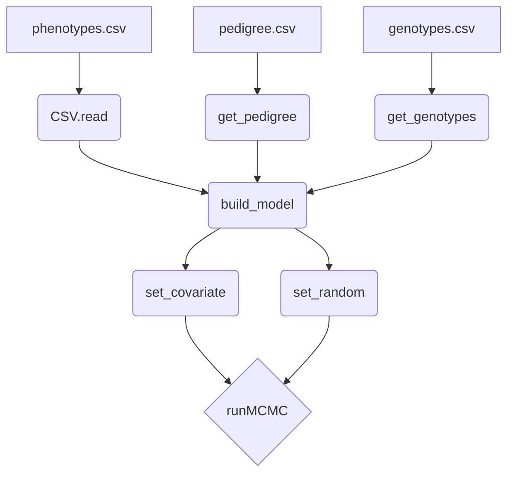

# JWAS.jl

## Opt-in no-copy dense matrix input

This version adds `copy_genotypes=false` to `get_genotypes` for workflows that
already own a correctly typed dense genotype matrix:

```julia
genotypes = get_genotypes(selected_float32_matrix;
                          method="BayesC",
                          double_precision=false,
                          quality_control=false,
                          copy_genotypes=false)
```

The default remains `copy_genotypes=true`, so existing callers are unchanged.
No-copy mode requires a concrete matrix whose element type matches the chosen
precision. JWAS adopts the matrix and may mutate it during imputation or
centering. File and DataFrame input continue to copy and reject no-copy mode.

## Shared dense multiclass BayesC

Overlapping BayesC classes can share one preprocessed dense genotype matrix:

```julia
base = get_genotypes(genotype_matrix, 1.0;
                     method="BayesC", Pi=0.99,
                     quality_control=false,
                     copy_genotypes=false)
classes = get_shared_genotype_classes(base, membership_matrix;
                                      add_unassigned=true,
                                      Pi=0.99)
```

The class objects contain zero-copy column views and independent BayesC model
state. Single-trait Annotated BayesC marker-specific pi samples are written with
one retained iteration per row and one marker per column.

Single-trait Annotated BayesC enrichment is also overlap-safe: each SNP's
additive variance is partitioned once across its active annotations using their
current leave-one-out probit contributions. SNPs without memberships are
reported as `Unannotated`. Annotation enrichment output is enabled by default;
retained annotation heritability and enrichment draws are written with one
iteration per row. Set `output_annotation_enrichment=false` to suppress it.

Single-trait multiclass BayesC also writes
`MCMC_samples_class_heritability.txt` when `output_heritability=true`. It uses a
covariance allocation so class contributions sum to total marker heritability
even when class designs overlap.

For single-trait dense BayesC with fast blocks,
`inner_outer_diagnostics=true` adds `InnerOuter_Model_Frequency` to the final
marker-effects output. This PIP uses every post-burn-in inner marker update;
the existing `Model_Frequency` remains the retained outer-iteration PIP.

[](https://github.com/reworkhow/JWAS.jl/actions/workflows/CI.yml)
[](https://codecov.io/gh/reworkhow/JWAS.jl)
[](https://reworkhow.github.io/JWAS.jl/latest)
<!---[](https://reworkhow.github.io/JWAS.jl/stable)--->


JWAS.jl is an open-source software tool written in Julia for Bayesian multiple regression methods applied to genomic prediction and genome-wide association studies.

* **Homepage**: [QTL.rocks](https://QTL.rocks)
* **Discussion group**: [available here](https://groups.io/g/qtlrocks)
* **Installation**: at the Julia REPL, `using Pkg; Pkg.add("JWAS")`
* **Documentation**: [manual and workflow guidance](http://reworkhow.github.io/JWAS.jl/latest/)
* **Examples**: [available on the JWAS wiki](https://github.com/reworkhow/JWAS.jl/wiki)
* **Authors**: [Hao Cheng](https://qtl.rocks), [Tianjing Zhao](https://animalscience.unl.edu/faculty-staff/tianjing-zhao), [Rohan Fernando](http://www.ans.iastate.edu/people/rohan-fernando), [Dorian Garrick](http://www.massey.ac.nz/massey/expertise/profile.cfm?stref=600130)


### Structure of JWAS




### Help

1. Show this README file in REPL or notebook using `?JWAS`
2. For help on a specific function above, type ? followed by its name, e.g. `?runMCMC` and press enter.
3. Run `Pkg.add(PackageSpec(name="JWAS", rev="master"))` to get the newest unofficial JWAS. Run `Pkg.free("JWAS")` to go back to the official one.

### Examples

The [JWAS documentation](http://reworkhow.github.io/JWAS.jl/latest/) contains the current manual and workflow guidance. Full example analyses are available on the [wiki](https://github.com/reworkhow/JWAS.jl/wiki).

* Single Trait Analysis
* Multiple Trait Analysis
* Repeated Measures
* Single Step Analysis
* Categorical Trait Analysis
* Censored Trait Analysis
* Joint Analysis of Continuous, Categorical, and Censored Traits
* Multi-class Bayesian Analysis
* Cross Validation
* Genome Wide Association Study
* Integrating Phenotypic Causal Networks in GWAS
* single trait and multiple trait GBLUP by providing the relationship matrix directly
* Description of Mixed Effects Model
* Quality Control of Genotypes
